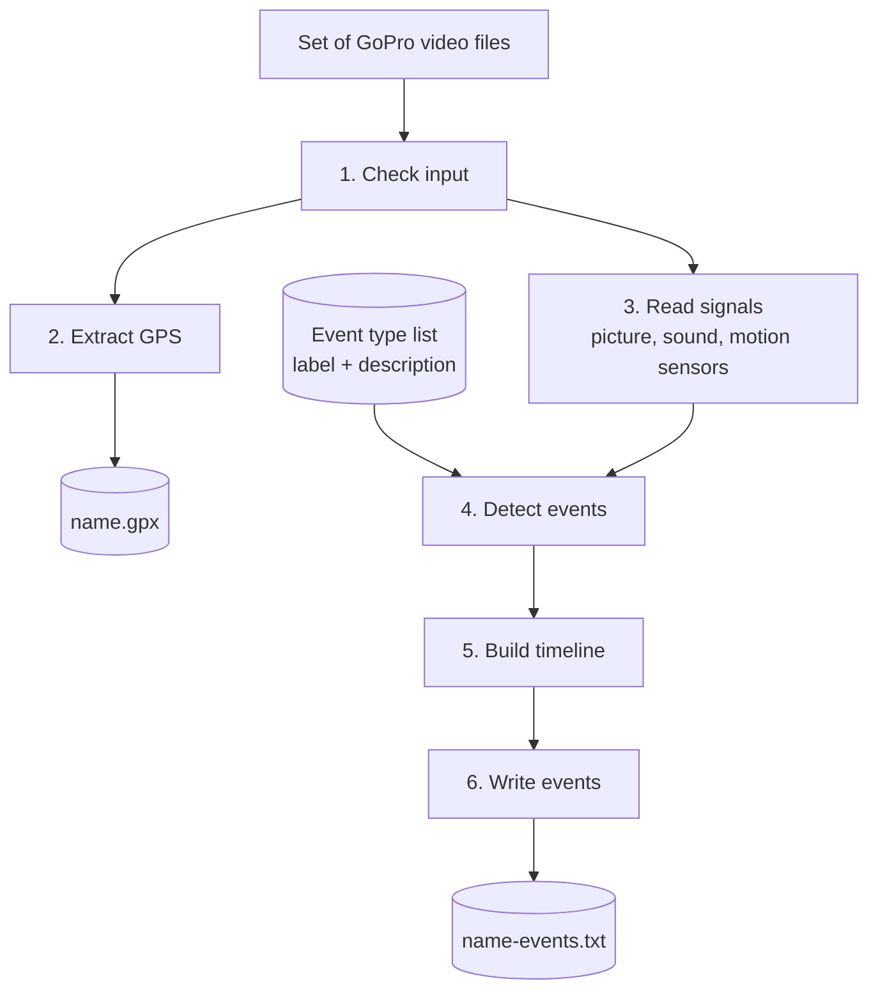

# GoPro trackday event extractor

Status: work in progress. GPS extraction works. Detected so far: warm up, cooling, sliding and leaving the track (from the camera's motion sensors) and the events involving other cars (overtaking, overtaken, held up). Obstacles and crashes are not detected yet.

## Goal

A trackday produces hours of in-car GoPro footage. To evaluate the driving, only the stretches where the track was clear are useful: a curve driven behind another car, during an overtake or after a slide says little about the driver's real pace.

This project reads GoPro footage filmed from inside a race car and writes, for each video, a list of what happened and when: where the track was clear, and where an event took place, such as overtaking, being overtaken, sliding, leaving the track or an obstacle on the road.

It also extracts the GPS track stored inside the GoPro file, so that other software can synchronise the video with a separate GPS logger.

The project is one module of a larger trackday analysis program.

## How it works



Each video is processed on its own and produces two files with the same base name as the video.

Example of an events file:

```
00:00 warm up
01:44 clear
02:31 offtrack
02:33 clear
```

## Setup

The project runs on Windows with Python 3.13 and an Nvidia graphics card.

1. **External tools.** Create a folder `executables` in the project folder and copy into it:
   - `exiftool.exe` with its `exiftool_files` folder, from [exiftool.org](https://exiftool.org) (rename `exiftool(-k).exe` to `exiftool.exe`);
   - `gpx.fmt`, ExifTool's GPX template, from the `fmt_files` folder of the full ExifTool distribution;
   - `ffmpeg.exe` and `ffprobe.exe`, from a build linked on [ffmpeg.org](https://ffmpeg.org/download.html) that supports Nvidia hardware decoding.
2. **Python libraries.** Create a virtual environment and install the libraries into it:
   ```
   py -V:3.13 -m venv .venv
   .venv\Scripts\python.exe -m pip install -r requirements.txt
   ```

## Use

```
.venv\Scripts\python.exe -m pp_tt_video "path\to\folder with videos"
```

For every video `name.mp4` this writes `name.gpx` and `name-events.txt` next to it. Files that already exist are left alone. Run the checks with `.venv\Scripts\python.exe -m unittest`.

## Documents

- [Business specification](BUSINESS_SPEC.md): what the module must do.
- [Technical specification](TECHNICAL_SPEC.md): how it is built.

## Example video

The example video will be linked here once it is uploaded.

## Note

This project is not affiliated with or endorsed by GoPro.
